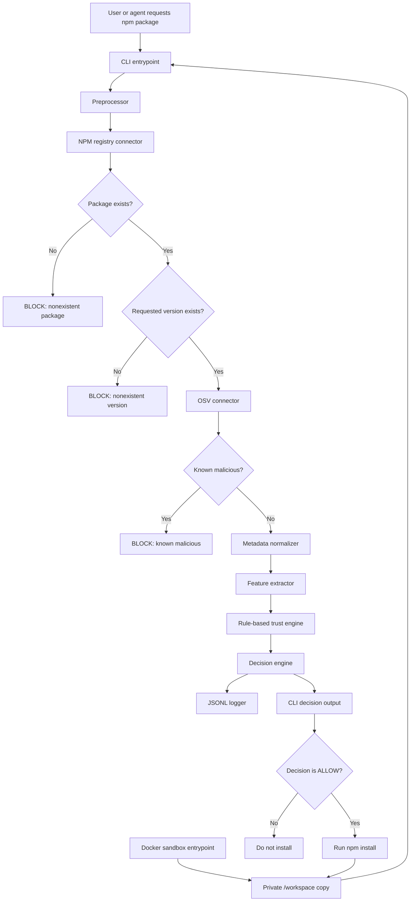
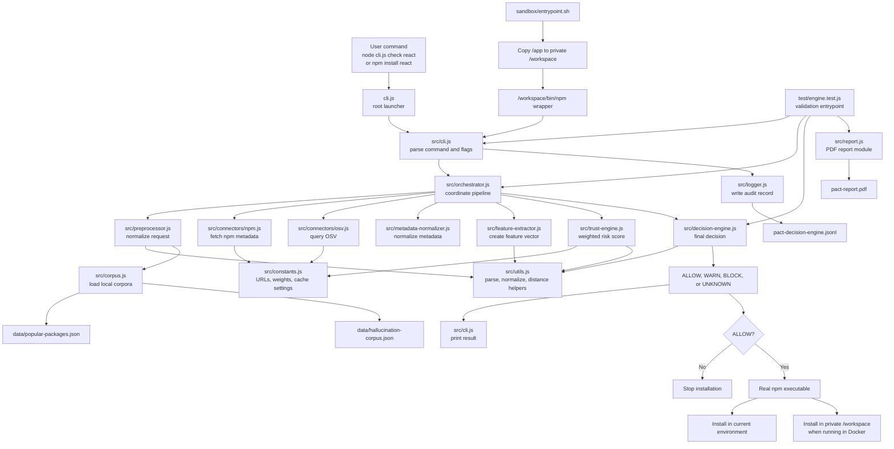

# PACT — Pre-Install Agentic Code Trust Layer: Complete Project Guide

This document explains the project from the outside in:

1. What problem it solves
2. The high-level architecture
3. The complete request flow
4. What every file is responsible for
5. How the risk score and confidence score work
6. How the Docker sandbox works
7. How to run, test, and demonstrate the project
8. What is implemented and what is still future work

---

## 1. Project Purpose

PACT is a rule-based security gate for npm package installation.

Its job is to inspect a requested npm package before installation and return one of four decisions:

- `ALLOW`: continue with installation
- `WARN`: stop and require user review or confirmation
- `BLOCK`: refuse the installation
- `UNKNOWN`: do not make a silent decision because a required external service failed

The main threat model is slopsquatting and related supply-chain risk:

- An AI agent invents a package name that does not exist.
- A user mistypes a popular package name and selects a typosquat.
- A package exists but contains suspicious install-time scripts.
- A package is extremely new or changes publisher/maintainer identity unexpectedly.
- A package has suspicious dependency, provenance, or release behavior.
- A package is known to be malicious in OSV or another advisory source.

The current project intentionally implements the deterministic rule-based engine. Machine learning, autonomous agent recovery, and broad multi-ecosystem support are future work.

---

## 2. High-Level Architecture

The system is organized as a pipeline:



There are two related execution modes:

### Direct check mode

```bash
node ./src/cli.js check react
```

This checks the package and reports a decision. It does not install the package.

### Gated install mode

```bash
node ./src/cli.js npm install react
```

This checks the package first. Only an `ALLOW` result reaches the real npm executable configured by `PACT_REAL_NPM` or the default `npm` command.

### Docker sandbox mode

```bash
docker run --rm -it -v "$PWD":/app:ro pact-sandbox sh /app/sandbox/entrypoint.sh
```

Inside the resulting container shell:

```bash
npm install react
```

The read-only `/app` mount contains the PACT source. The entrypoint copies it into a private container-only `/workspace`, creates an npm wrapper there, changes into `/workspace`, and exposes the wrapper first in `PATH`. The resulting `node_modules` is created inside the container workspace and disappears when the container exits.

### File-to-file runtime flow

This is the concrete path through the repository when a user runs a package check or a gated install:



### File traversal in order

| Step | File or artifact | Responsibility | Passes control or data to |
| ---: | --- | --- | --- |
| 1 | `cli.js` | Root launcher that imports the actual CLI. | `src/cli.js` |
| 2 | `src/cli.js` | Parses commands, package names, flags, output mode, logging, and sandbox commands. | `src/orchestrator.js`, `src/logger.js`, or `src/sandbox.js` |
| 3 | `src/orchestrator.js` | Coordinates one complete package analysis. | `src/preprocessor.js` |
| 4 | `src/preprocessor.js` | Validates npm, normalizes the name/version, detects tags, and finds nearest corpus names. | `src/utils.js`, `src/corpus.js` |
| 5 | `src/corpus.js` | Loads the local package-name lists. | `data/popular-packages.json`, `data/hallucination-corpus.json` |
| 6 | `src/utils.js` | Performs text normalization, package parsing, edit distance, script matching, date calculations, and range checks. | Returns helper values to the caller |
| 7 | `src/connectors/npm.js` | Calls the npm registry, resolves the requested version, handles 404s, and caches raw responses. | `src/orchestrator.js` |
| 8 | `src/connectors/osv.js` | Queries OSV and classifies malicious/advisory results. | `src/orchestrator.js` |
| 9 | `src/metadata-normalizer.js` | Converts raw npm metadata into the internal metadata schema. | `src/feature-extractor.js` |
| 10 | `src/feature-extractor.js` | Converts metadata into normalized risk features and availability information. | `src/trust-engine.js` |
| 11 | `src/trust-engine.js` | Multiplies feature values by configured weights and creates the contribution breakdown. | `src/decision-engine.js` |
| 12 | `src/decision-engine.js` | Applies short-circuit rules and thresholds, then calculates confidence and explanation. | `src/orchestrator.js` |
| 13 | `src/orchestrator.js` | Builds the compact decision and full evidence record. | `src/cli.js` |
| 14 | `src/logger.js` | Appends the full evidence record as one JSON line. | `pact-decision-engine.jsonl` |
| 15 | `src/cli.js` | Prints text/JSON output and invokes npm only for an aggregate `ALLOW`. | Terminal or npm |
| 16 | `src/report.js` | Converts decision entries into a minimal PDF report. | Chosen PDF output path |
| 17 | `sandbox/entrypoint.sh` | Copies the read-only project into `/workspace` and creates the container-local npm wrapper. | `/workspace/bin/npm`, then `src/cli.js` |
| 18 | `sandbox/Dockerfile` | Defines the Node/Alpine image used for the sandbox. | Docker container |
| 19 | `test/engine.test.js` | Runs preprocessing, scoring, live package checks, CLI, report, and dry-run tests. | Node test runner |

### Decision branches by file

#### Nonexistent package

```text
src/orchestrator.js
  -> src/connectors/npm.js returns exists=false
  -> orchestrator creates BLOCK: nonexistent_package
  -> src/cli.js prints the decision
  -> src/logger.js records it
  -> npm is never invoked
```

#### Known malicious package

```text
src/orchestrator.js
  -> npm connector confirms package exists
  -> src/connectors/osv.js returns malicious=true
  -> orchestrator creates BLOCK: known_malicious
  -> result is printed and logged
  -> metadata scoring and npm install are skipped
```

#### Normal allowed package

```text
src/orchestrator.js
  -> src/metadata-normalizer.js
  -> src/feature-extractor.js
  -> src/trust-engine.js
  -> src/decision-engine.js returns ALLOW
  -> src/cli.js invokes real npm
  -> npm installs in the current working directory
```

When the same flow runs through `sandbox/entrypoint.sh`, the final installation occurs in the private container `/workspace` instead of the host project directory.

---

## 3. Complete Request Flow

### Allowlist branch

Before registry and OSV analysis, the CLI checks the persistent allowlist:

```text
package request
  -> src/allowlist.js
  -> exact package-name match?
       -> yes: BYPASS, log explicit user trust, continue to npm
       -> no: normal registry/OSV/rule-engine pipeline
```

Manage it with:

```bash
pact allow add @mycompany/internal-sdk
pact allow list
pact allow remove @mycompany/internal-sdk
```

The default file is `~/.config/pact/allowlist.json`. Set `PACT_ALLOWLIST_FILE` to use another file. A `BYPASS` decision has `risk_score: null` and `confidence: null` because PACT intentionally did not analyze the package; it is different from an `ALLOW` decision.

### Step 1: The user types a command

Examples:

```bash
node ./src/cli.js check react
node ./src/cli.js check react lodash express --json
node ./src/cli.js npm install react
node ./src/cli.js sandbox shell
node ./src/cli.js sandbox install react
```

In Docker, the user can type the shorter command after entering the sandbox shell:

```bash
npm install react
```

### Step 2: The CLI parses arguments

`src/cli.js` identifies:

- the top-level command: `check`, `npm`, or `sandbox`
- the npm subcommand, such as `install`
- package specifications
- `--json`
- `--dry-run`
- `--log-file <path>`
- `--timeout-ms <number>`

The CLI then calls the orchestrator for every package specification.

### Step 3: The preprocessor normalizes the request

`src/preprocessor.js` and `src/utils.js`:

- trim whitespace
- lowercase text
- apply Unicode NFKC normalization
- preserve npm scopes such as `@scope/name`
- split a package into name and version/tag
- identify tags such as `latest`, `next`, `beta`, `alpha`, and `canary`
- reject unsupported ecosystems
- reject ambiguous non-registry references such as `git+...`, `https://...`, `file:...`, paths, and other URLs
- calculate nearest matches against popular packages
- calculate nearest matches against the hallucination corpus

For example:

```text
@Scope/Name@latest
```

becomes approximately:

```json
{
  "scope": "@scope",
  "full_name": "@scope/name",
  "version": "latest",
  "resolved_tag": "latest",
  "resolved_via_unpinned_tag": true,
  "ecosystem": "npm"
}
```

The nearest-match calculation uses Levenshtein edit distance. A small distance means the name resembles another name closely.

### Step 4: The npm registry connector checks existence

`src/connectors/npm.js` requests package metadata from:

```text
https://registry.npmjs.org/<package-name>
```

It resolves the requested version in one of these ways:

- no version supplied: use the npm `latest` tag
- known dist-tag supplied: resolve that tag
- exact semantic version supplied: look for that exact version
- unsupported version expression: fall back to npm `latest` in the current implementation

The connector returns:

- whether the package exists
- whether the requested version exists
- the resolved version
- the resolved tag
- raw package metadata
- raw metadata for the selected version

Registry responses are cached in memory for 15 minutes using the package name and requested version as the key.

#### Package does not exist

The orchestrator immediately returns:

```text
BLOCK
reason: blocked: nonexistent_package
confidence: 1.0
```

This is the primary hallucinated-package signal.

#### Package exists but version does not exist

The orchestrator returns:

```text
BLOCK
reason: blocked: nonexistent_version
confidence: 1.0
```

This distinguishes a fake package from a fake version of a real package.

#### Registry failure

A timeout or non-404 registry failure becomes:

```text
UNKNOWN
confidence: 0
```

The system does not silently treat an unavailable registry as safe.

### Step 5: OSV is queried

`src/connectors/osv.js` sends a request to:

```text
https://api.osv.dev/v1/query
```

with a payload shaped like:

```json
{
  "package": {
    "name": "react",
    "ecosystem": "npm"
  },
  "version": "<resolved-version>"
}
```

The connector extracts:

- `malicious`
- vulnerability/advisory list
- advisory count
- known CVE count
- maximum severity
- availability status

If an advisory looks explicitly malicious, based on identifiers or text such as `MAL-`, `malicious`, `malware`, or `typosquat`, the orchestrator immediately returns:

```text
BLOCK
reason: blocked: known_malicious
confidence: 1.0
```

Ordinary vulnerabilities are not automatically treated as malicious. They remain available as a risk feature.

### Step 6: Metadata is normalized

`src/metadata-normalizer.js` converts npm-shaped metadata into a stable internal object.

The normalized object includes:

- package name and resolved version
- first publish and current version timestamps
- all version publish timestamps
- dist-tags
- maintainers and maintainer count
- author, license, homepage, repository, and bug URLs
- description and keywords
- dependencies and dependency version ranges
- lifecycle scripts: `preinstall`, `install`, `postinstall`, and `prepare`
- `bin` entry presence
- integrity hashes
- provenance information
- provenance history
- download information

This isolates the feature extractor from the exact shape of the npm API.

### Step 7: Features are extracted

`src/feature-extractor.js` converts metadata into normalized risk features. Each feature is intended to be between `0` and `1`:

- `0`: no suspicious signal
- `1`: maximum suspicious signal

The extracted feature vector contains:

| Feature | Meaning |
| --- | --- |
| `package_age_risk` | New packages are riskier than established packages. The starting age window is 90 days. |
| `version_age_risk` | A recently published version can be riskier than an old stable version. |
| `release_burstiness_risk` | Many recent releases in a short period may indicate unusual activity. |
| `unusual_tag_risk` | `next`, `beta`, `alpha`, and `canary` are treated as more unusual than `latest` or an exact version. |
| `lifecycle_script_risk` | Install scripts containing network/download/shell/execution patterns are high risk. |
| `executable_flag_risk` | A `bin` entry is more concerning for a new or low-download package. |
| `provenance_regression_risk` | A current version losing provenance after earlier versions had it is suspicious. |
| `publisher_changed_risk` | Reserved for publisher identity changes. |
| `maintainer_changed_risk` | Reserved for maintainer changes. |
| `dependency_risk` | Broad ranges, URL dependencies, and a high dependency count increase risk. |
| `name_similarity_risk` | A name close to a popular package may be a typosquat. |
| `hallucination_corpus_risk` | A name close to a known hallucination/fake-package corpus increases risk. |
| `popularity_risk` | Very low download volume contributes a small risk signal. |
| `cve_risk` | OSV advisories and severity contribute vulnerability risk. |

Some features are currently calculated but are not part of the weighted trust table. This is intentional room for future tuning. In particular, `release_burstiness_risk` and `executable_flag_risk` are extracted but are not currently assigned a weight in `TRUST_ENGINE_WEIGHTS`.

### Step 8: The rule-based trust engine calculates risk

`src/trust-engine.js` applies the configured weights from `src/constants.js`.

The core equation is:

```text
risk_score = sum(weight_i * feature_value_i)
```

The current weights are:

| Feature | Weight | Interpretation |
| --- | ---: | --- |
| `hallucination_corpus_risk` | 0.20 | Strong slopsquatting/hallucination signal. |
| `lifecycle_script_risk` | 0.18 | Direct install-time execution risk. |
| `name_similarity_risk` | 0.14 | Typosquat resemblance to a popular package. |
| `package_age_risk` | 0.10 | New package signal. |
| `dependency_risk` | 0.10 | Suspicious dependency behavior. |
| `provenance_regression_risk` | 0.08 | Loss of a previously present trust signal. |
| `publisher_changed_risk` | 0.06 | Publisher identity change. |
| `maintainer_changed_risk` | 0.05 | Maintainer identity change. |
| `version_age_risk` | 0.04 | New version signal. |
| `unusual_tag_risk` | 0.03 | Non-stable tag signal. |
| `cve_risk` | 0.01 | Vulnerability signal, separate from maliciousness. |
| `popularity_risk` | 0.01 | Low popularity signal. |

These weights sum to `1.0`. A feature's contribution is:

```text
contribution = feature_value * weight
```

The engine records every contribution, sorts them from largest to smallest, and returns:

- total risk score
- contribution breakdown
- feature completeness

### Step 9: The decision engine thresholds the risk

`src/decision-engine.js` applies the starting thresholds:

```text
risk >= 0.75       BLOCK
0.40 <= risk < .75 WARN
risk < 0.40       ALLOW
```

The engine also handles the short-circuit decisions from earlier stages. These are intentionally stronger than a weighted score because package nonexistence and known maliciousness are direct findings.

### Step 10: Confidence is calculated separately

Confidence is not the same as risk.

- `risk_score`: how suspicious the package looks
- `confidence`: how sure the engine is about its decision

Confidence considers:

- metadata completeness
- agreement between the strongest signals
- the final risk level
- the decision class (`ALLOW`, `WARN`, or `BLOCK`)

The current confidence path combines evidence completeness, signal agreement, and risk direction without forcing every `ALLOW` result above a presentation threshold. It is still a heuristic confidence estimate, not a calibrated probability, and should eventually be validated against labeled benchmark data.

### Step 11: The result is printed and logged

The compact decision is printed to the user. A typical human-readable result is:

```text
ALLOW: react
  confidence=0.970 risk=0.020
  reason=ALLOW: version_age_risk=0.020, hallucination_corpus_risk=0.000, lifecycle_script_risk=0.000
Aggregate: ALLOW
```

With `--json`, the same result is returned as structured JSON.

Every evaluated package is appended as one JSON object per line to the configured log file. The default is:

```text
pact-decision-engine.jsonl
```

The log entry keeps a SHA-256 hash of the raw registry response plus selected metadata fields as evidence, while the compact CLI decision avoids printing the entire registry response to the terminal. This prevents repeated full packuments from creating oversized logs.

### Step 12: Installation is either allowed or stopped

For `pact npm install ...`:

- if every requested package is `ALLOW`, the wrapper invokes the real npm executable
- if any package is `WARN`, the wrapper stops
- if any package is `BLOCK`, the wrapper stops
- if any package is `UNKNOWN`, the wrapper stops

The aggregate priority is:

```text
BLOCK > UNKNOWN > WARN > ALLOW
```

This means one blocked package prevents the complete install command from proceeding.

---

## 4. Docker Sandbox Flow

### The host mount

The recommended command mounts the project read-only:

```bash
docker run --rm -it -v "$PWD":/app:ro pact-sandbox sh /app/sandbox/entrypoint.sh
```

The `:ro` suffix means the container cannot write to the host project directory through `/app`.

### The entrypoint

`sandbox/entrypoint.sh` performs these actions:

1. Sets `WORKSPACE=/workspace` unless `PACT_SANDBOX_WORKDIR` overrides it.
2. Finds the real npm binary inside the image.
3. Removes any previous `/workspace` directory.
4. Creates `/workspace`.
5. Copies the read-only project from `/app` into `/workspace`.
6. Creates `/workspace/bin/npm`.
7. Makes that wrapper executable.
8. Sets `PACT_REAL_NPM` to the real npm path.
9. Places `/workspace/bin` before the normal `PATH`.
10. Changes directory to `/workspace`.
11. Runs the provided command, or opens a shell if no command was provided.

The generated npm wrapper runs:

```sh
node /app/src/cli.js npm "$@"
```

The source code is read from `/app`, but the current working directory is `/workspace`. When PACT eventually invokes the real npm binary, npm writes `node_modules` and lockfiles into `/workspace`, not into the host project.

### Important distinction

This is safe:

```bash
docker run --rm -it -v "$PWD":/app:ro pact-sandbox sh /app/sandbox/entrypoint.sh
```

This is not the intended sandbox entrypoint:

```bash
docker run --rm -it -v "$PWD":/app -w /app pact-sandbox sh
```

The second command opens a plain shell in a writable bind-mounted directory. It can cause npm to write into the host project. Use the entrypoint command for demonstrations.

---

## 5. File-by-File Responsibilities

### Root files

#### `README.md`

Short project introduction, basic usage, and scope. It is the quick-start document.

#### `PROJECT_GUIDE.md`

This document. It explains the architecture and implementation in detail.

#### `package.json`

Defines the Node project:

- package name and version
- ES module mode via `type: module`
- the `pact` binary mapping
- npm scripts such as `npm test`
- Node version requirement
- project dependencies if present

#### `package-lock.json`

Records npm dependency resolution for reproducibility. It should normally be generated and maintained by npm rather than edited manually.

#### `cli.js`

A root-level convenience launcher:

```js
import './src/cli.js';
```

It allows commands like:

```bash
node cli.js check react
```

without requiring the user to remember the `src/` path.

#### `PACT-decision-engine-LLD.pdf`

The original low-level design reference supplied for the project. It describes the intended pipeline and future ML-swappable architecture.

#### `pact-decision-engine.jsonl`

A runtime decision log generated by the logger. Each line is a separate JSON decision record. It is evidence data, not source code.

### Data files

#### `data/popular-packages.json`

A local list of popular npm package names used for edit-distance comparison. It supports typosquat detection.

#### `data/hallucination-corpus.json`

A local list of package names associated with hallucination or fake-package patterns. It supports slopsquatting detection.

### CLI and orchestration

#### `src/cli.js`

The user-facing command dispatcher. It:

- prints usage
- parses flags
- extracts package specifications
- reads dependencies from `package.json` when no explicit install specs are supplied
- calls the orchestrator
- writes JSONL decisions
- prints human-readable or JSON output
- aggregates decisions across multiple packages
- invokes real npm only after an `ALLOW`
- launches Docker sandbox commands

It is responsible for workflow control, not for deciding whether a package is trustworthy.

#### `src/orchestrator.js`

The central pipeline coordinator. It calls each stage in order:

1. preprocess request
2. query npm
3. short-circuit missing package/version
4. query OSV
5. short-circuit known malicious result
6. normalize metadata
7. extract features
8. score with the rule engine
9. apply decision thresholds
10. construct compact and full log objects

This is the main ownership point for the end-to-end decision flow.

#### `src/preprocessor.js`

Builds the normalized request object. It handles ecosystems, package scopes, tags, versions, and nearest corpus matches.

#### `src/utils.js`

Shared low-level utilities:

- clamping values to a range
- text normalization
- package-spec parsing
- semantic-version recognition
- dist-tag recognition
- Levenshtein distance
- nearest-corpus lookup
- date arithmetic
- suspicious-script matching
- broad dependency-range detection
- ISO timestamp conversion
- age-risk calculations

### Connectors

#### `src/connectors/npm.js`

The npm registry adapter. It owns HTTP requests to the npm registry, version resolution, 404 handling, and in-memory response caching.

#### `src/connectors/osv.js`

The OSV adapter. It owns OSV POST requests, caching, advisory extraction, severity ranking, and malicious-advisory classification.

### Normalization and scoring

#### `src/metadata-normalizer.js`

Converts raw npm metadata into the common internal metadata shape used by the extractor.

#### `src/feature-extractor.js`

Calculates the normalized risk features and an availability map. The availability map is used to estimate how complete the evidence is.

#### `src/trust-engine.js`

Applies the weighted rule-based formula. It does not decide `ALLOW`, `WARN`, or `BLOCK`; it only produces a risk score and contribution breakdown.

#### `src/decision-engine.js`

Converts a score plus short-circuit facts into an action. It also calculates confidence and creates a human-readable reason from the largest contributions.

#### `src/constants.js`

Central configuration for:

- npm registry URL
- OSV URL
- cache TTL
- default log file
- package age threshold
- corpus size limit
- trust weights
- expected features
- recognized dist-tags

### Output and sandbox support

#### `src/logger.js`

Creates a JSONL logger. It ensures the parent directory exists and appends one serialized object per decision.

#### `src/report.js`

Creates a minimal PDF file from decision entries. It currently writes a simple text report containing package name, action, risk, confidence, and reason.

The current CLI does not expose a dedicated `report` subcommand; report generation is available as a module and is covered by tests. A future CLI command can read the JSONL file and call `generatePdfReport`.

#### `src/sandbox.js`

Provides sandbox-related helpers:

- `evaluateInstallSpec`: evaluate one package through the orchestrator
- `dockerAvailable`: check whether the Docker daemon responds
- `runSandboxInstall`: evaluate packages and then run an install in Docker
- `buildSandboxCommand`: construct the Docker shell command

#### `sandbox/Dockerfile`

Base image definition for the sandbox. It uses Node 20 Alpine and disables npm fund/audit noise in the image configuration.

#### `sandbox/entrypoint.sh`

The actual isolation bootstrap described in the Docker section. It creates the private workspace and redirects plain `npm` commands to PACT.

### Tests

#### `test/engine.test.js`

Node's built-in test suite. It currently tests:

- scoped-name and dist-tag preprocessing
- suspicious lifecycle-script scoring
- immediate blocking for nonexistent packages
- allowed decisions for known-good packages such as React, Lodash, Express, and Chalk
- PDF creation
- multi-package JSON CLI output
- dry-run behavior without creating `node_modules` or a lockfile

The live package tests call the npm registry and OSV, so network availability can affect test duration or produce `UNKNOWN` results.

---

## 6. Commands

### Install project dependencies

```bash
npm install
```

### Run unit/integration tests

```bash
npm test
```

### Check one package without installing

```bash
node cli.js check react
```

### Check multiple packages as JSON

```bash
node cli.js check react lodash express chalk --json
```

### Run the gated npm wrapper

```bash
node cli.js npm install react
```

Use dry-run when you only want the decision:

```bash
node cli.js npm install react --dry-run
```

### Use the Docker sandbox

Build the image if needed:

```bash
docker build -t pact-sandbox -f sandbox/Dockerfile .
```

Open the isolated shell:

```bash
docker run --rm -it -v "$PWD":/app:ro pact-sandbox sh /app/sandbox/entrypoint.sh
```

Inside the shell:

```bash
npm install react
npm install lodash express chalk
```

Run a one-shot check inside Docker:

```bash
docker run --rm -v "$PWD":/app:ro pact-sandbox sh /app/sandbox/entrypoint.sh sh -lc 'node /app/src/cli.js check react --json'
```

Run the one-shot sandbox install command from the host:

```bash
node cli.js sandbox install react
```

That command evaluates the package first and asks Docker to perform the actual installation only when the decision is `ALLOW`.

---

## 7. Panel Demonstration Script

A clean demonstration can follow this sequence:

### A. Explain the problem

Say:

> An AI agent or developer can request a package that is misspelled, hallucinated, or malicious. PACT inserts a decision gate before npm installation.

### B. Start the sandbox

```bash
docker build -t pact-sandbox -f sandbox/Dockerfile .
docker run --rm -it -v "$PWD":/app:ro pact-sandbox sh /app/sandbox/entrypoint.sh
```

### C. Show a safe check

```bash
node /app/src/cli.js check react --json
```

Point out:

- package exists
- requested version resolves
- OSV has no malicious result
- feature values are mostly zero
- risk score is low
- confidence is high
- decision is `ALLOW`

### D. Show the normal-looking install command

Inside the same container shell:

```bash
npm install react
```

Explain that `npm` is not the original shell command here. The container's `/workspace/bin/npm` wrapper receives it first, invokes PACT, and only calls the real npm binary after an `ALLOW` decision.

### E. Show multiple safe packages

```bash
npm install lodash express chalk
```

The wrapper checks each package and aggregates the results. All must be allowed for the install command to proceed.

### F. Show the audit trail

From another host terminal, after exiting the container:

```bash
node cli.js check react lodash express chalk --json --log-file demo.jsonl
```

Then inspect:

```bash
cat demo.jsonl
```

The JSONL file contains the structured evidence used by the decision.

### G. Explain the safety boundary

Say:

> The project is mounted into `/app` read-only. The container copies it to `/workspace`, and npm writes only to that private workspace. When the container is removed, the installed packages disappear with it.

---

## 8. Decision and Confidence Interpretation

A sample successful decision might look like:

```json
{
  "decision": "ALLOW",
  "risk_score": 0.020,
  "confidence": 0.970
}
```

Interpret it as:

- `ALLOW`: the policy threshold permits installation
- `risk_score`: the package has very little suspicious signal
- `confidence`: the available evidence is complete and consistent enough for the engine to be confident

These values do not mean mathematical certainty. The current rule weights and confidence formulas are initial policy settings. They should eventually be calibrated with a labeled benchmark containing:

- known legitimate packages
- typosquats
- hallucinated package names
- packages with suspicious scripts
- known malicious packages
- packages with ordinary CVEs but no malicious classification

---

## 9. Current Limitations and Future Work

### Current limitations

- npm is the only fully implemented ecosystem.
- The popular and hallucination corpora are local starter lists, not a complete 5,000-package production corpus.
- Publisher and maintainer change features are reserved but not fully derived from historical metadata.
- Release burstiness and executable-entry features are extracted but not currently weighted in the trust table.
- The PDF generator is intentionally minimal and there is no public CLI report command yet.
- The normal `pact npm install` wrapper runs npm in its current environment. Use the Docker entrypoint or `pact sandbox install` when the requirement is strict host isolation.
- The current OSV malicious classifier is heuristic and should be replaced or supplemented with authoritative malicious-package feeds.
- There is no internal/private registry namespace for dependency-confusion detection.
- Confidence is an evidence-based heuristic, not a probability; it should be empirically calibrated before being treated as a production metric.

### Future work

- Add a dedicated `pact report` command that converts JSONL logs into PDF.
- Add a proper registry connector interface and PyPI implementation.
- Expand the package corpus and use popularity/download data from a maintained source.
- Add historical publisher and maintainer comparison.
- Add dependency graph analysis rather than only direct dependency metadata.
- Add an ML trust engine behind the same `score()` interface.
- Add confirmation handling for `WARN` instead of simply stopping.
- Add an isolated, non-networked or restricted-network Docker policy for installing and observing package scripts.
- Add benchmark fixtures and calibration metrics for false positives, false negatives, block rate, and hallucination detection rate.

---

## 10. One-Sentence Summary

PACT is a deterministic, explainable security gate that checks an npm package's identity, registry existence, advisory status, metadata, install behavior, and supply-chain signals before allowing installation, with Docker available to isolate the actual install from the host machine.
