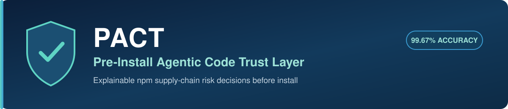
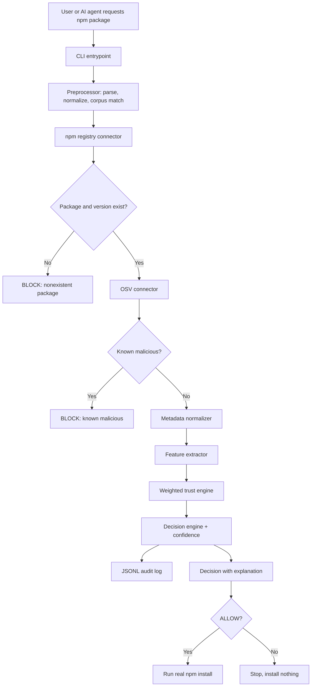
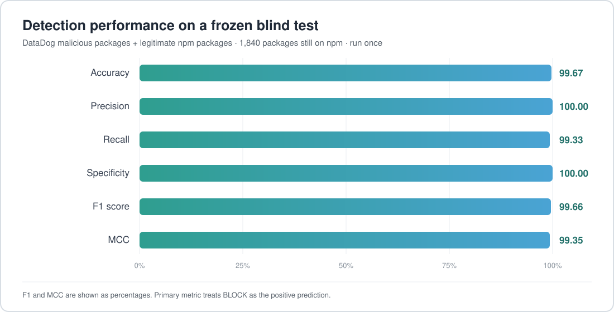

<p align="center">
  
</p>

# PACT — Pre-Install Agentic Code Trust Layer

**An explainable, rule-based trust layer that decides whether code fetched by an AI coding agent is safe to install.**

PACT sits between a developer — or an AI coding agent — and `npm install`. It resolves the requested package, verifies that it actually exists, checks known-malicious advisories, inspects registry metadata and supply-chain signals, and returns a decision with a full evidence trail: `ALLOW`, `WARN`, `BLOCK`, or `UNKNOWN`.

The project was motivated by **slopsquatting**: AI coding agents frequently hallucinate plausible-looking package names, and attackers can register those names to distribute malware. PACT makes the "should I install this?" decision explicit, deterministic, and auditable before any package is fetched onto the host.

## Contents

[Highlights](#highlights) · [Architecture](#architecture) · [Evaluation](#evaluation) · [Quick start](#quick-start) · [Repository layout](#repository-layout) · [Scope and future work](#scope-and-future-work)

---

## Highlights

- **Deterministic and explainable** — a weighted score (`risk = Σ weightᵢ × featureᵢ`) plus a sorted contribution breakdown for every decision.
- **Short-circuit safety rules** — nonexistent packages and OSV-confirmed malicious packages are blocked directly, without relying on the score.
- **Fails closed** — external-service failures produce `UNKNOWN` instead of a silent `ALLOW`.
- **Install gating** — `pact npm install ...` only forwards to the real npm binary when the aggregate decision is `ALLOW`.
- **Isolated execution** — an optional Docker sandbox installs into a private, container-only workspace, keeping the host clean.
- **Human review for warnings** — a `WARN` asks once per command (`[y/N]`, default No) when a person is at the terminal; approvals are remembered per exact version. AI agents and CI cannot approve their own installs.
- **Validated on independent data** — **99.67% accuracy, 100% precision, and no legitimate package blocked** on a frozen blind test PACT had never seen (see [Evaluation](#evaluation)).

---

## Architecture



Each stage is a separate module under `src/`, so the registry connector, scoring model, and decision policy can be replaced independently. The full request flow and per-file responsibilities are documented in [`PROJECT_GUIDE.md`](PROJECT_GUIDE.md).

### Decision model

| Decision | Condition | Meaning |
| --- | --- | --- |
| `ALLOW` | `risk < 0.40` | Proceed with installation. |
| `WARN` | `0.40 ≤ risk < 0.75`, or a review rule | Ask for human review (`[y/N]`) in a terminal; stop in CI or agent use. |
| `BLOCK` | `risk ≥ 0.75`, or a direct finding | Refuse installation. |
| `UNKNOWN` | Required external check failed | Do not make a silent decision. |

Policy rules can block regardless of the score. Two block rules: an install script that runs a randomly named file, and a one-letter lookalike of a popular package that has an install script, both limited to packages with fewer than 10,000 weekly downloads.

Risk features include hallucination-corpus membership, lifecycle-install scripts, name similarity to popular packages, package/version age, dependency anomalies, provenance regressions, and publisher/maintainer changes. `confidence` is computed separately from `risk`: it reflects evidence completeness and signal agreement, not suspicion level.

---

## Evaluation

PACT was tested once on a frozen blind dataset it had never seen: 1,000 malicious packages from DataDog's malicious-software-packages dataset and 946 legitimate npm packages. The case list was frozen before the run; nothing was downloaded or executed. The results below cover the 1,840 packages still available on npm.¹

<p align="center">
  
</p>

| Metric (`BLOCK` positive) | Result |
| --- | ---: |
| Accuracy | **99.67%** |
| Precision | 100.00% |
| Recall | 99.33% |
| Specificity | 100.00% |
| F1 | 0.9966 |
| Balanced accuracy | 99.66% |
| MCC | 0.9935 |

<p align="center">
  
</p>

On a second blind dataset (Amalfi, ICSE 2022; 1,114 packages), PACT blocked **99.6%** of malicious packages (456 of 458) and no legitimate package still on npm.

¹ 106 packages labelled malicious are excluded because npm had already neutralized them: 65 replaced with npm's `0.0.1-security` placeholder, and 41 fully unpublished. On those 41, PACT returns `UNKNOWN` and stops the install. Complete results: [`analysis/2026-11-21-external-test/`](analysis/2026-11-21-external-test/).

---

## Quick start

Requires Node.js 18+.

```bash
npm install
npm test

# Inspect a package without installing it
node ./src/cli.js check react
node ./src/cli.js check lodash express --json

# Gate a real install behind the decision
node ./src/cli.js npm install react
```

The wrapper blocks on `BLOCK`, asks for review on `WARN` (`--allow-warn` approves one run, `--no-prompt` never asks), and only forwards to `npm install` on `ALLOW`. Every decision is appended to `pact-decision-engine.jsonl` with its full evidence record.

A check prints the decision, the risk score, the confidence, and the signals that drove the result:

```text
ALLOW: react
  confidence=0.970 risk=0.020
  reason=ALLOW: version_age_risk=0.020, hallucination_corpus_risk=0.000, lifecycle_script_risk=0.000
Aggregate: ALLOW
```

### Private and local packages

Packages you own can be explicitly trusted. They return `BYPASS`, skip the public npm/OSV checks, and are logged as an explicit user decision — not as a security result.

```bash
node ./src/cli.js allow add @mycompany/internal-sdk
node ./src/cli.js allow list
node ./src/cli.js allow remove @mycompany/internal-sdk
```

The allowlist lives at `~/.config/pact/allowlist.json`; override it with `PACT_ALLOWLIST_FILE`.

### Docker sandbox

To keep the installed package entirely off the host:

```bash
docker build -t pact-sandbox -f sandbox/Dockerfile .
docker run --rm -it -v "$PWD":/app:ro pact-sandbox sh /app/sandbox/entrypoint.sh
```

The entrypoint copies the read-only source into a private `/workspace`, installs an npm wrapper there, and discards the resulting `node_modules` when the container exits.

---

## Repository layout

```text
src/            CLI, orchestrator, connectors, normalization, scoring, decision, logging
data/           Local popular-package and hallucination corpora
test/           Node test suite for preprocessing, scoring, CLI, and reporting
scripts/        Shell npm wrapper used by the gated install path
sandbox/        Dockerfile and isolated entrypoint
analysis/       Dataset verification, evaluator, metrics, and root-cause study
docs/           README diagram and chart assets
PROJECT_GUIDE.md  Full architecture and file-by-file walkthrough
PACT-decision-engine-LLD.pdf  Low-level design document
```

---

## Scope and future work

This implementation intentionally focuses on the deterministic rule-based engine for npm. Deliberate next steps include a PyPI connector, expanded and externally maintained corpora, historical publisher/maintainer analysis, dependency-graph analysis, a pluggable ML trust engine behind the same `score()` interface, and empirical calibration of the confidence heuristic. Current limitations are documented in [`PROJECT_GUIDE.md`](PROJECT_GUIDE.md#9-current-limitations-and-future-work).
